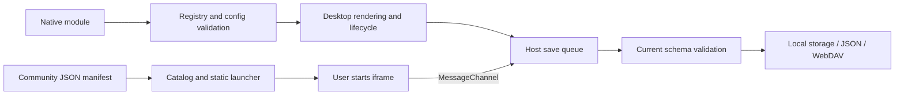

# Widget overview and architecture

[Wiki home](Home-en.md) · [简体中文](Widgets-Overview.md) · **English**

## Choose an integration model

See [Footer quotes](#footer-quotes) for the footer interaction and API details.

| Dimension | Native API v3 | Community protocol v1 |
| --- | --- | --- |
| Distribution | Local ES Module, reviewed and bundled | Self-hosted HTTPS webpage and JSON manifest |
| Registration | `src/widget-extensions.js` | User subscribes to a manifest or source index |
| Desktop rendering | Author renderer at every declared size | Static launcher; webpage runs explicitly in a detail window |
| Data API | Declared `config`, `getConfig()` / `updateConfig()` | `host.data` / `host.save(value)` |
| Execution | Trusted host environment; not a sandbox | `sandbox="allow-scripts"` iframe + MessageChannel |
| Updates | Extension or web application release | Refresh the source, then explicitly update installed manifests |

Native source can access its execution environment; its API is not a permission boundary. Community APIs do not expose other desktop data, but author webpages can make network requests. See [community widgets](Community-Widgets-en.md) for isolation limits.

## Built-in catalog

### Fixed controls and repeated additions

The Add window has a 46 px single-row header containing search, the target group, maximize and close. Categories remain above the independently scrolling card list. Narrow windows keep search and window controls together and turn the side navigation into a horizontal strip. Initial focus goes to the title; keyboard users can reach search, categories, size previews and Add, scroll the list with PageDown, and close with Escape to return to the launcher.

Adding a widget or website shortcut keeps the window open, including its query, category, target group, individual preview sizes, scroll position and maximized state. Feedback appears inside the window. A pending save blocks duplicate activation of that button; after completion, another intentional addition creates an independent instance. A failed save preserves the current choices for retry. A save that finishes after closing does not close or replace a different window.

References reviewed on 2026-10-18: the user's iTab visual baseline and its [public entry](https://go.itab.link/), [MDN overflow](https://developer.mozilla.org/en-US/docs/Web/CSS/Reference/Properties/overflow), and the [WAI-ARIA modal dialog pattern](https://www.w3.org/WAI/ARIA/apg/patterns/dialog-modal/). Qiye retains preview cards and navigation, chooses a 46 px header, separates the scroll region with an accessible name and keyboard focus, and preserves explicit dismissal and focus return. Card content, persistence formats and date/time calculations are unchanged. `tests/catalog-e2e.py` covers source, standalone preview and an optional public URL.

### Desktop context menus

The compact visual reference is the [public iTab desktop](https://go.itab.link/) and its [right-click add instructions](https://www.itab.link/guide/skills.html). At 100% scale, Qiye uses a 176 px menu width, 30 px action rows, 12 px text, 15 px icons, 5 px padding and 10 px corners. Card-size buttons are 26 px tall and retain all sizes and actions. These are Qiye's adaptation values, not an official iTab size specification. Desktop, website, folder, widget and group menus share these styles and retain viewport bounds. The sidebar footer groups Add group, Local search and Settings in one container, using a shared 6 px [CSS `gap`](https://developer.mozilla.org/en-US/docs/Web/CSS/Reference/Properties/gap) at 100% scale. This prevents extra spacing between a separate button and the button group, and applies to left/right sidebars and top navigation. Icon appearance and extraction options remain under Settings → Icons.

Implementation references: [WAI-ARIA menu pattern](https://www.w3.org/WAI/ARIA/apg/patterns/menubar/) and [MDN `:focus-visible`](https://developer.mozilla.org/en-US/docs/Web/CSS/Reference/Selectors/:focus-visible). Existing buttons, keyboard focus and Escape dismissal remain available. Styling does not remove keyboard focus indicators or focus settings controls when opening with the pointer. This change only adjusts menu density and the sidebar shortcut; it does not change card data, persistence formats or date/time logic.

### Widget list

The registry provides the user-facing built-in widgets below. `community` is a separate internal type. Legacy `hotlinks` and `focus` types remain only to validate and migrate existing data; neither appears in the catalog. All built-ins support the five sizes.

| Type | Name | Behavior and limits |
| --- | --- | --- |
| `wallpaper` | Wallpapers | Every size opens the wallpaper center; galleries load on demand |
| `bookmarks` | Bookmarks | Nested folder tree on the left, bookmarks on the right; independent data and authorized browser bookmarks stay separate |
| `weather` | Weather | Independent city, unit and network opt-in; observations, hourly/daily forecasts and air quality |
| `calendar` | Calendar | Gregorian/lunar dates, events, date and workday tools; verified mainland China adjustments for 2026 only |
| `memo` | Memos | Multiple plain-text entries, search, pinning, sorting, autosave, undo deletion and TXT export |
| `notes` | Sticky notes | Independent text and color |
| `todo` | To-dos | Add, complete and delete tasks |
| `countdown` | Countdown | Event title and target date |
| `pomodoro` | Pomodoro | Focus, short/long breaks, a task per round, daily goals and completed sessions; each next phase starts manually |
| `workday` | Workday countdown | Working days, end time and payday |
| `quote` | Quotes | Custom text/author or built-in quotes |
| `hotsearch` | Trending | 22 sources, categories/search, subscription ordering, single/multiple lists, refresh and local cache; opens directly to rankings |
| `codec` | Encoding tools | Base64 / URL and other conversions, MD / SHA hashes, and Buddha, Beast and Bear formats |
| `file-converter` | File converter | Batch PNG / JPG / WebP conversion, processed locally with no uploads; [details](../FILE_CONVERTER.md) |
| `converter` | Converter | 20 tools including base conversion, 117 units and 40 currencies; [details](../CONVERTER.md) |
| `habit` | Habits | Daily records and streaks |
| `clock` | World clock | IANA timezone, city label and time comparison |


## Encoding tools

Add **Widgets → Tools → Encoding tools**. All five sizes open a dedicated workspace; 2×2 / 4×2 cards include Base64, URL and MD5 shortcuts. The workspace has a 46px single-row title bar with its name and window controls; long titles are truncated with the full name available on hover. It uses algorithm navigation and side-by-side input/output editors, switching to an algorithm selector and stacked editors on narrow screens. It includes live conversion, manual execution, Ctrl / ⌘ + Enter, examples, clear, copy and reuse of output as input.

- Reversible formats: Base64, Base64 URL, URL parameters / full URLs / form values, HTML entities, Unicode escapes, UTF-8 hex and JSON strings. HTML supports `amp`, `lt`, `gt`, `quot`, `apos`, `nbsp` and numeric entities; other named entities remain unchanged. Only URL form mode decodes `+` as a space.
- One-way hashes: MD2, MD4, MD5, SHA-1, SHA-256, SHA-384 and SHA-512, with lowercase or uppercase hex output. Hash mode has no decode operation. Empty text can be hashed manually. MD algorithms and SHA-1 are for legacy compatibility, not password storage or secure signatures.
- Playful formats include classic Buddha (`佛曰：`, excluding newer Buddha variants), the original framed Beast translator, and original Bear (`熊曰：呋`, also accepting the shorter `呋` prefix). Beast supports a custom alphabet of four distinct characters, excluding whitespace and emoji. Decoding detects the alphabet from the opening and closing markers; the original text can include Chinese and emoji. These formats have public alphabets and fixed parameters, with no password protection.
- Standard formats use UTF-8; classic Buddha uses UTF-16LE and Beast operates on UTF-16 code units. Original whitespace, line breaks and BOM are preserved. Playful decoders allow line breaks in encoded text. Invalid encodings show an error and clear stale results. Input is limited to 100,000 UTF-16 code units. Larger standard-format output can be copied but cannot be reused directly. Playful output is also limited to 100,000 units, so Beast accepts up to 12,499 input units; Bear additionally bounds streamed decompression bytes.
- Text and custom Beast alphabets remain only in the current tool window's memory, clear on close, make no network requests and are excluded from persistence, backups and WebDAV. The widget's title, size and placement are saved normally. SHA and classic Buddha use browser Web Crypto and require the extension, HTTPS / localhost, or a local-file environment that supports it. Bear uses native Compression Streams without loading external scripts.

The independent MD implementations are checked against standard vectors from [RFC 1319](https://www.rfc-editor.org/rfc/rfc1319), [RFC 1320](https://www.rfc-editor.org/rfc/rfc1320) and [RFC 1321](https://www.rfc-editor.org/rfc/rfc1321). Base64 follows [RFC 4648](https://www.rfc-editor.org/rfc/rfc4648).

Playful format references, versions and published compatibility fixtures are recorded in [Third-party references](../THIRD_PARTY.md#趣味编码格式参考).

## Base conversion within Converter

Add **Widgets → Tools → Converter**, then choose **Base converter**. Existing base-converter cards migrate automatically, keeping their input, output bases, integer settings, title and placement. The shared 46px title bar provides category search, contextual settings and window controls.

The input spans the workspace above compact, aligned result rows. Binary, octal, decimal and hexadecimal appear together by default; add or remove outputs from bases 2–36 with **Choose bases**. Formatting and input examples start collapsed. The five desktop card sizes remain supported; 2×2 / 4×2 cards show the first four results when the latest category is base conversion. Preferences and radix input share one save queue across categories, including retry after a failed save. See [Converter](../CONVERTER.md) for design references and verification.

- Input is limited to 512 characters. Exact rational arithmetic preserves large integers and fractions beyond JavaScript's safe integer range. Accepts negatives, case-insensitive letters, space / underscore groups and recurring notation such as `0.(3)`. Pasting a complete `0b`, `0o` or `0x` number detects its input base.
- Choose 1–128 maximum fractional digits. Parentheses mark recurring digits; longer expansions are truncated, not rounded, and show `≈` and `…`. General mode retains a minus sign for negatives. Scientific notation is not supported.
- Copy individual results or all results. Individual copies omit grouping spaces and announce truncation when applicable; copying all preserves base labels and approximation markers. Only exact results within the input limit can be reused as input.
- Each instance independently saves its input, output bases and formatting in desktop data, JSON backups and WebDAV. Public layout sharing resets these to defaults. Conversion needs no network access; failed saves retain session drafts and offer retry.

Switch between **General / Signed / Unsigned** above the workspace. Integer modes offer 8, 16, 32, 64 and 128 bits. Compact aligned result rows sit below side-by-side signed and unsigned decimal interpretations. The bit view groups four digits, labels bit indices and highlights the highest bit (the sign bit in Signed mode). Integer formatting starts collapsed; minimum / maximum and zero, highest-bit-only and all-ones shortcuts fill the input.

- **General** preserves arbitrary-precision signed numbers and fractions and is the migration default for older data.
- **Numeric value** reads a mathematical value in the selected base and validates the range. Signed 8-bit values span −128 to 127; unsigned span 0 to 255. All widths, including 64 and 128 bits, use exact integer arithmetic.
- **Bit pattern** reads a nonnegative raw pattern in the selected base. For example, 8-bit hexadecimal `FF` means signed −1 or unsigned 255. Decimal results show the selected interpretation; other bases show the raw pattern. Binary, octal and hexadecimal pad to the word width by default; formatting can disable this.
- Switching Signed / Unsigned preserves valid bits. Switching input interpretation and reusing a result preserves the corresponding value or pattern. Changing width or input base reinterprets the input: widening raw `FF` from 8 to 16 bits produces 255. Returning to General keeps the currently interpreted mathematical value.
- Out-of-range values, invalid digits and noninteger fractions clear results and show an error, without truncation or wrapping. Mode, width, input interpretation and padding persist per widget. Copy all includes width and both decimal interpretations.

The multi-base programmer workflow references [Microsoft Calculator](https://github.com/microsoft/calculator). Two's-complement and unsigned semantics follow [MDN BigInt.asIntN](https://developer.mozilla.org/en-US/docs/Web/JavaScript/Reference/Global_Objects/BigInt/asIntN) and [BigInt.asUintN](https://developer.mozilla.org/en-US/docs/Web/JavaScript/Reference/Global_Objects/BigInt/asUintN). This widget validates ranges before conversion to avoid silently dropping high bits. Separate numeric and bit-pattern inputs distinguish the mathematical value of `FF` from its signed interpretation.

## Bookmark manager

Following the user's iTab reference, the window has a single 48 px title bar (44 px in narrow windows), with a folder tree on the left and a compact list directly below it on the right. There is no Recent navigation entry or large content banner. The title bar contains source switching, the current path, search, sorting, actions, Manage, settings and window controls. Long paths truncate and expand into an ancestor menu. The plus menu creates folders and bookmarks, and renames / edits, moves or deletes the current folder or a single selected item. Narrow windows use icons and expandable search to keep one row.

Add **Widgets → Productivity → Bookmarks**. The default 4×2 card displays folders and links side by side; all five sizes open the manager. Search matches names and addresses across folders, shows their locations and can jump to the containing folder. Ctrl / Cmd + F or K focuses search. Menus support keyboard activation, Escape and outside-click dismissal. Layout references include the [Firefox Library](https://support.mozilla.org/en-US/kb/bookmarks-firefox); disclosures use native [details / summary](https://developer.mozilla.org/en-US/docs/Web/HTML/Reference/Elements/details).

Drag a bookmark or folder onto a sidebar folder, the middle of a folder row, or a path-menu entry to move it. In Original order, dragging between rows reorders siblings; insertion lines and folder highlights distinguish the destinations. Name and date sorting only affect presentation; search and sorted views do not accept insertion drops. The interaction follows [Firefox manual bookmark ordering](https://support.mozilla.org/en-US/kb/sort-bookmarks-quickly-find-ones-you-want) and the [HTML Drag and Drop API](https://developer.mozilla.org/en-US/docs/Web/API/HTML_Drag_and_Drop_API), accepting only drags started inside the component.

Manage shows checkboxes in the tree and list, plus select-all, move and delete controls in the title bar. Selection persists across folders; selected items can also be dragged together. Ctrl / Cmd + A selects the current list; Escape exits management. The row ellipsis selects one item and opens the title-bar actions. Selected descendants are handled once through their selected ancestor. Move destinations exclude selected folders and descendants; recursive deletion reviews affected counts. Qiye batches validate before one storage write and retain drafts on failure. Native operations run sequentially, following [bookmarks.move](https://developer.mozilla.org/en-US/docs/Mozilla/Add-ons/WebExtensions/API/bookmarks/move); partial failure reports completed work and keeps only the unfinished selection for retry.

Qiye bookmarks are independent per widget and included in JSON backups and WebDAV. Public layout sharing clears their content. Each widget supports 5,000 items and paths of 64 levels. New addresses accept HTTP / HTTPS, default to HTTPS without a scheme and reject duplicates within a folder. Manual order survives reload.

In the extension, choosing Browser bookmarks requests optional permission. Authorized changes directly affect the original collection and external changes refresh the view. Every write rechecks access and the reviewed node. The browser tree remains in memory, outside backups and WebDAV; sources never automatically import into each other. Denied or revoked access leaves Qiye bookmarks available. System folders and managed collections cannot be batch-selected for modification. Existing special addresses remain visible without executing them. See the [Chrome Bookmarks API](https://developer.chrome.com/docs/extensions/reference/api/bookmarks).

## Pomodoro

Add **Widgets → Productivity → Pomodoro**. The default rhythm is 25 minutes of focus, a 5-minute short break, and a 15-minute long break after 4 completed focus rounds. Durations, cycle length, daily goal and completion chime are configurable, with 25 / 5 and 50 / 10 presets. Changes preserve running or paused rounds and apply immediately to idle phases.

The single-line header is 48px high. Focus, short-break and long-break inputs sit above the dial, always visible. Type minutes and press Enter or Apply times; starting an idle timer also saves the entered durations. Focus accepts 1–180 minutes, short breaks 1–60 and long breaks 1–120. Cycle length, daily goal and chimes remain under More settings. Failed saves preserve typed drafts for retry.

The old Focus timer is removed from the catalog and new desktops. Existing cards and backups migrate to Pomodoro while preserving identity, placement, size, custom names, duration and running/paused progress. Stopped timers at zero return to a ready state without inventing completion records.

Design references: [Pomofocus](https://pomofocus.io/) for customizable focus/break rhythms and [MDN number inputs](https://developer.mozilla.org/en-US/docs/Web/HTML/Reference/Elements/input/number) for labels, range and step constraints. Based on the supplied screenshot, duration controls move above the dial with labeled integer inputs, local validation and keyboard access, while the shorter header frees vertical space.

The leaf-topped dial uses distinct focus and break palettes. The 1×1 card opens the workspace; 1×2 and 2×1 provide start/pause controls; 2×2 shows the timer and daily harvest; 4×2 adds the current task and cycle progress. The dedicated workspace includes phase selection, a focus task, daily goal progress, today's six most recent sessions and rhythm settings, with responsive layouts, light/dark themes and Chinese/English support.

Only a naturally completed focus round earns a tomato. Resetting or ending early does not count. The next phase waits for a manual start, so time away cannot produce fictional sessions. Deadlines survive page closure; completed rounds belong to the local date of their actual completion timestamp. Tasks stay locked during running/paused rounds, and records preserve their original task and duration. Each instance stores its most recent 2,000 sessions in desktop data and JSON/WebDAV backups. Optional chimes require an open page and browser playback permission; a suspended page reconciles elapsed time on return.

## Trending lists

Existing Trending links cards and `hotlinks` records in older backups upgrade automatically, preserving IDs, placement, sizes and custom names. Background updates stay off by default; there is no need to delete and recreate cards.

Add **Widgets → Trending**, then open the card to read ranks, titles and popularity immediately. The reading window uses a 1000 × 660 layout, shrinking on smaller screens and showing at least 13 ranks at its standard size. Automatic background updates are off by default; opening, switching or refreshing a list still loads it. Previously read headlines also appear in the desktop card. Zhihu, Weibo, 52pojie and GitHub are followed by default. Manage subscriptions supports adding/removing sources, dragging, up/down buttons and Alt + up/down arrow keys. The toolbar includes categories, platform search, single/multiple lists and maximize controls.

Lists use the [UAPI hotboard endpoint](https://uapis.cn/docs/api-reference/get-misc-hotboard) by default. Source settings also accept a public HTTPS service compatible with [DailyHotApi](https://github.com/imsyy/DailyHotApi). GitHub uses its public API: repositories created in the last 7 days sorted by stars; the AI list uses the last 30 days with the `artificial-intelligence` topic. These are not GitHub's official Trending lists. Entries without article links still display their titles, with a platform link available separately.

Subscriptions, order, selected platform, view and service URL are saved per instance and included in backups/WebDAV. List caches remain local, are reused for 10 minutes, and retain at most 48 lists for up to 7 days. Failed requests preserve cached content and expose retry. Closing the workspace cancels unneeded requests; multiple-list loading uses at most 3 concurrent requests. Public layout imports turn off automatic background updates. Availability and update times depend on upstream services. Serve standalone HTML over HTTP for network testing; `file://` previews may be blocked by the provider's CORS policy.

## Runtime structure



Cards and detail workspaces share instance data. Compact built-in cards show summaries. Calendar, memos and weather have dedicated detail views; other daily tools use workspace modules. Detail layouts reflow with the available space.

| Module | Responsibility |
| --- | --- |
| [widget-registry.js](../../src/widget-registry.js) | Types, API versions, fields, defaults and validation |
| [widget-extensions.js](../../src/widget-extensions.js) | Bundled definitions shared across execution contexts |
| [widget-sizes.js](../../src/widget-sizes.js) / [widget-catalog.js](../../src/widget-catalog.js) | Dimensions, catalog and static previews |
| [widget-runtime.js](../../src/widget-runtime.js) / [widget-settings.js](../../src/widget-settings.js) | Native lifecycle and generated configuration forms |
| [widgets.js](../../src/widgets.js) / [widget-summary.js](../../src/widget-summary.js) | Cards, built-in interactions and compact summaries |
| [widget-workspaces.js](../../src/widget-workspaces.js) / [widget-details.js](../../src/widget-details.js) | Daily workspaces, calendar and memo sessions |
| [calendar-view.js](../../src/calendar-view.js) / [memo-view.js](../../src/memo-view.js) / [weather-view.js](../../src/weather-view.js) | Dedicated views |
| [widget-data.js](../../src/widget-data.js) / [widget-drafts.js](../../src/widget-drafts.js) | Instance data, drafts, failed saves and retry |
| [community-format.js](../../src/community-format.js) / [community-widget.js](../../src/community-widget.js) | Manifests, instance JSON and isolated execution |
| [core.js](../../src/core.js) / [validation.js](../../src/validation.js) | Full desktop validation, storage and backups |

## Data model and limits

Each widget card has `config` and `data`. Native extensions keep declared scalar fields in `config` and use `data: {}`. Built-ins have explicit data structures; community widgets store a JSON string in `data.value`. Duplicating a card deep-copies its content; newly created cards receive fresh defaults.

```js
// Card fragment, not a complete importable desktop backup.
{
  id: 'stable-id', groupId: 'home', type: 'widget', widget: 'counter',
  title: 'Counter', size: '2x2', config: { label: 'Small wins today', count: 3 }, data: {}
}
```

| Data | Per-instance limit |
| --- | --- |
| Calendar `events` | 500 events; 160-character titles |
| Memo `entries` | 200 entries; 120-character titles and 100000-character bodies |
| Sticky `notes` | 100000 characters |
| `todos` | 500 items; 1000-character text per item |
| `habits` | 100 items; 3660 dates per item |
| `pomodoro` | Focus 1–180 minutes, short breaks 1–60, long breaks 1–120; up to 2,000 completed sessions |
| Community `value` | 64 KiB of UTF-8 JSON text |
| Full desktop backup | 6 MiB; web storage also depends on browser quotas |

The current format is `schemaVersion: 5`, stored under `qiye.state.v5`. Unknown types, missing/unknown fields, unsupported sizes and older formats are rejected. Import validation never fills missing fields with defaults. Do not persist DOM objects, functions, timers, credentials or caches.

## Calendar, drafts and weather

Calendar tools use local civil dates. The workday interval tool **excludes the start date and includes the end date**; the same day yields zero. The underlying `countWorkdays` function includes both endpoints, and the tool explicitly subtracts the start date. Statutory adjustments and cultural festivals are separate; unverified years are not guessed. The calendar engine is bundled offline; see [third-party notices (Chinese)](../THIRD_PARTY.md).

Editors such as memos use `widget-drafts.js` to retain failed drafts in the current page. Reloading or closing the page loses unsaved drafts: retry or export first. `Qiye-unsaved-widget.json` is not a full desktop backup. A stale draft cannot overwrite a newer revision from another tab.

Weather is disabled by default and never reads precise device location. Sources include Automatic, Open-Meteo, QWeather, Hong Kong Observatory, Taiwan CWA and Macao SMG. Automatic mode prefers the applicable regional observations, then configured QWeather, then Open-Meteo. HKO selects a nearby temperature station, CWA selects a nearby WGS84 station, and HKO/SMG supply official daily forecasts. Open-Meteo supplements hourly and missing daily forecasts, with separate attribution. Missing official observations remain unknown; qualitative rain probabilities are not converted to invented percentages. CAMS air quality is explicitly US AQI.

QWeather uses the current v1 coordinate APIs with a personal API Host and key; CWA requires a personal authorization key. Credentials remain in separate local storage, excluded from desktop exports, WebDAV and sharing. Old weather configurations inherit `source: auto` and `fallback: true`; other required fields remain strictly validated. Fallback can be disabled. Source requests time out after eight seconds (air quality: 4.5 seconds). Forecasts stay fresh for 30 minutes, retry after one minute on failure and preserve up to seven days of cached data. Cache identities include coordinates, region, source, fallback, credential revision and language. Memory holds 64 combinations and local storage 48. Web previews obey provider CORS; SMG XML requires optional origin access in the extension.

City searches time out after eight seconds and newer requests cancel earlier ones. [weather-workspace.js](../../src/weather-workspace.js) manages the workspace; [weather-chart.js](../../src/weather-chart.js) breaks curves at missing values instead of inserting zero. [weather-cities.js](../../src/weather-cities.js) separately retains eight recent cities, deduplicated by coordinates. Saved-city summaries load when weather is enabled and the city sidebar opens. Common mainland, Hong Kong, Taiwan and Macao searches support local simplified/traditional and English aliases, with Open-Meteo geocoding used when no local match exists. City history, credentials and weather caches are excluded from backups and WebDAV.

The weather window follows the supplied iTab screenshots: search and sidebars start closed, and Add city, Cities and Settings share the title bar with maximize and close. Add city opens and focuses the sidebar search. Cities and settings share a contrasting sidebar with independent scrolling, while the forecast stays visible without a scrim. The window expands to preserve the main width when space permits; narrow windows stack the panels. Switching panels retains the forecast and scroll positions; Escape closes the panel and restores focus to its trigger. The layout uses [CSS Grid](https://developer.mozilla.org/en-US/docs/Web/CSS/Guides/Grid_layout/Basic_concepts) and keyboard focus uses [:focus-visible](https://developer.mozilla.org/en-US/docs/Web/CSS/Reference/Selectors/:focus-visible). Opening settings focuses its heading before the form controls.

Refresh sits next to the city and observation time; the current temperature and °C / °F use the same font size and baseline. The [Web Animations API](https://developer.mozilla.org/en-US/docs/Web/API/Element/animate) coordinates a 460 ms window and sidebar expansion with a small panel rebound. Closing takes 280 ms; the outgoing panel remains painted but inert until it finishes. Rapid reversals resume from the current visual position, resizing settles the layout, and the forecast and scroll positions remain intact. Both the app’s reduced-effects setting and system [prefers-reduced-motion](https://developer.mozilla.org/en-US/docs/Web/CSS/Reference/At-rules/@media/prefers-reduced-motion) skip the animation.

[Next: native widget API →](Native-Widgets-en.md) · [Community widgets →](Community-Widgets-en.md)

## Footer quotes

The footer shows only the quote; hovering over it displays the author and source in its tooltip. Clicking it copies the text; the success notification and check icon clear after about 1.2 seconds. Hovering or focusing with the keyboard reveals copy, refresh, search and Hitokoto icons on the right without shifting the quote. Touch devices show the actions directly. Search uses the selected engine and search opening preference; the Hitokoto icon opens the original entry. Each visit still fetches a real random quote, and refresh requests another. Offline, cached or local quotes rotate.

References checked on 2026-10-15: the user's iTab-style layout, the [official Hitokoto API and UUID link examples](https://developer.hitokoto.cn/sentence/), and [MDN's Clipboard.writeText() example](https://developer.mozilla.org/en-US/docs/Web/API/Clipboard/writeText). The service link moves to an icon. Copy writes plain text only after a click, reports success or failure, and adds no clipboard permission. See the [privacy notes](../PRIVACY.md#页底一言) for network and cache boundaries.
