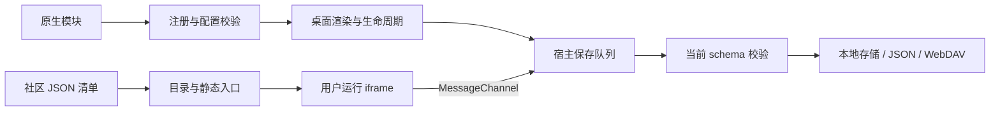

# 组件概览与架构

[Wiki 首页](Home.md) · **简体中文** · [English](Widgets-Overview-en.md)

## 接入方式选择

页底短句的交互与接口说明见[页底一言](#页底一言)。

| 维度 | 原生组件 API v3 | 社区组件协议 v1 |
| --- | --- | --- |
| 交付方式 | 本地 ES Module，经源码审阅后打包 | 自托管 HTTPS 网页与 JSON 清单 |
| 注册入口 | `src/widget-extensions.js` | 用户订阅清单或来源索引 |
| 桌面展示 | 每个声明尺寸均使用作者渲染器 | 静态入口，详情窗口显式运行网页 |
| 数据接口 | 声明式 `config`、`getConfig()` / `updateConfig()` | `host.data` / `host.save(value)` |
| 执行环境 | 与宿主同一可信环境；不是沙箱 | `sandbox="allow-scripts"` iframe + MessageChannel |
| 更新 | 随扩展或网页版发布 | 刷新来源后，用户选择更新已添加的清单 |

原生组件源码可访问所在执行环境，API 不是权限边界。社区接口不暴露其他桌面数据，但作者网页仍可自主联网；隔离范围见[社区组件](Community-Widgets.md)。

## 内置组件目录

### 固定工具栏与连续添加

添加窗口采用 46 px 单行标题栏，搜索、目标分组、放大和关闭位于同一固定区域；分类按钮固定在列表上方，只有卡片列表滚动。窄屏保留同排搜索与窗口按钮，并将左侧入口变为可横向浏览的导航。窗口打开时先聚焦标题，键盘仍可访问搜索、分类、尺寸与添加按钮，也可以用 PageDown 浏览列表、Esc 关闭并返回原入口。

添加小组件或网址导航后窗口保持打开，保留搜索词、分类、目标分组、各组件预览尺寸、滚动位置及放大状态。添加结果显示在窗口内；同一按钮保存期间阻止重复触发，保存结束后可以继续添加独立实例。保存失败不会显示成功，保留当前选择供重试；关闭窗口后完成的保存不会关闭或替换新打开的窗口。

2026-10-18 参考用户提供的 iTab 视觉基线及其[公开入口](https://go.itab.link/)，保留目录预览与分类导航；46 px 标题栏和连续添加是栖页的具体交互选择。按照 [MDN overflow](https://developer.mozilla.org/en-US/docs/Web/CSS/Reference/Properties/overflow) 将滚动限制在有明确高度的列表，并为键盘滚动区提供名称和焦点；按照 [WAI-ARIA 模态对话框模式](https://www.w3.org/WAI/ARIA/apg/patterns/dialog-modal/) 保留标题焦点、窗口内键盘导航、显式关闭按钮和关闭后的焦点返回。卡片内容、保存格式与日期时间算法不变。验证脚本为 `tests/catalog-e2e.py`，同时覆盖源码、单文件预览及指定公开网址。

### 桌面右键菜单

右键菜单以 [iTab 公开桌面](https://go.itab.link/)及其[右键添加说明](https://www.itab.link/guide/skills.html)为紧凑视觉参考。栖页在 100% 比例下采用 176 px 菜单宽度、30 px 常规行高、12 px 字号、15 px 图标、5 px 内边距和 10 px 圆角；卡片尺寸按钮为 26 px 高，保留全部尺寸与操作。以上为本项目的适配尺寸，并非 iTab 官方尺寸规格。桌面、网站、文件夹、组件及分组共用这套样式，继续按可用视口限制菜单边界。侧边栏底部依次排列添加分组、本地搜索与设置，三个按钮放在同一容器内，以 [CSS `gap`](https://developer.mozilla.org/en-US/docs/Web/CSS/Reference/Properties/gap) 统一为 6 px 间距（100% 比例），避免独立按钮与按钮组的边距叠加；左右侧栏与顶部导航共用该间距。图标外观及提取选项仍位于“设置 → 图标”。

实现参考 [WAI-ARIA 菜单模式](https://www.w3.org/WAI/ARIA/apg/patterns/menubar/)和 [MDN `:focus-visible`](https://developer.mozilla.org/en-US/docs/Web/CSS/Reference/Selectors/:focus-visible)：保留原有按钮、键盘聚焦与 Esc 关闭行为，样式调整不移除键盘焦点提示，也不因鼠标打开菜单额外聚焦设置控件。此次只调整菜单密度与侧边栏入口，不修改卡片数据、持久化格式或日期时间逻辑。

### 组件列表

书签组件使用左侧多层文件夹树和右侧收藏列表，使用方式见下方“书签管理”。

注册表提供下列用户可选内置组件；`community` 是单独的内部类型，旧 `hotlinks` 和 `focus` 类型仅用于校验并迁移已有数据，不再提供添加入口。全部内置组件支持五种尺寸。

| 类型 | 名称 | 内容与边界 |
| --- | --- | --- |
| `wallpaper` | 在线壁纸 | 所有尺寸打开壁纸中心；图库按需联网 |
| `bookmarks` | 书签 | 左侧多层文件夹树、右侧收藏列表；独立收藏与授权后的浏览器原生收藏分开管理 |
| `weather` | 天气 | 独立城市 / 单位 / 联网开关，当前天气、小时与每日预报、空气质量 |
| `calendar` | 日历 | 公历 / 农历、日程、日期与工作日工具；中国调休仅提供已核实的 2026 年数据 |
| `memo` | 备忘录 | 多条纯文本记录、搜索、置顶、排序、自动保存、删除撤销与 TXT 导出 |
| `notes` | 便签 | 桌面随手记，独立文本与颜色 |
| `todo` | 待办 | 添加、勾选、删除任务 |
| `countdown` | 倒数日 | 配置事件标题与目标日期 |
| `pomodoro` | 番茄钟 | 专注 / 短休 / 长休循环、独立事项、每日目标与完成记录；下一阶段手动开启 |
| `workday` | 下班倒计时 | 设置工作日、下班时间与发薪日 |
| `quote` | 每日一句 | 自定义摘录与作者，或内置短句 |
| `hotsearch` | 热搜榜 | 22 个来源，分类 / 搜索、订阅排序、单榜 / 多榜、刷新与本机缓存；点击直接查看榜单 |
| `codec` | 编码工具 | Base64 / URL 等转换、MD / SHA 摘要，以及佛曰、兽音译者、熊曰 |
| `file-converter` | 文件转换 | PNG / JPG / WebP 本地批量互转，不上传图片；详见 [文件转换](../FILE_CONVERTER.md) |
| `converter` | 换算器 | 20 类计算与换算（含进制转换）、117 个单位、40 种货币；详见 [说明](../CONVERTER.md) |
| `habit` | 习惯打卡 | 每日记录与连续天数 |
| `clock` | 世界时钟 | IANA 时区、城市标签与时间比较 |


## 编码工具

从“添加 → 小组件 → 工具 → 编码工具”添加。五种卡片尺寸均可打开专用窗口，2×2 / 4×2 提供 Base64、URL、MD5 快捷入口。窗口采用 46px 单行标题栏，保留名称与窗口操作；长标题省略显示，悬停可查看全名。桌面窗口采用算法导航与输入 / 输出双栏，小屏切换为算法下拉框与上下排列；支持实时转换、手动执行、Ctrl / ⌘ + Enter、示例、清空、复制和结果继续作为输入。

- 可逆转换：Base64、Base64 URL、URL 参数值 / 完整地址 / 表单值、HTML 实体、Unicode 转义、UTF-8 十六进制和 JSON 字符串。HTML 支持 `amp`、`lt`、`gt`、`quot`、`apos`、`nbsp` 与数字实体；其他命名实体原样保留。URL 只有表单模式将 `+` 解码为空格。
- 单向摘要：MD2、MD4、MD5、SHA-1、SHA-256、SHA-384、SHA-512，可输出大写或小写十六进制。哈希模式没有解码操作，空文本可以手动计算摘要。MD 系列与 SHA-1 用于旧系统兼容，不用于密码存储或安全签名。
- 趣味编码：经典佛曰（`佛曰：`，不兼容佛又曰 / 新佛曰）、兽语 / 兽音译者（带首尾标记的原版格式）、原版熊曰 / 与熊论道（`熊曰：呋`，也可解码以 `呋` 开头的文本）。兽音可填写 4 个不同的非空白、非 emoji 字符作为字表，解码自动从首尾识别字表；原文可包含中文和 emoji。这些格式用于文本趣味分享，字表与固定参数公开，不提供密码保护。
- 普通格式以 UTF-8 处理文本；经典佛曰使用 UTF-16LE，兽音按 UTF-16 代码单元转换。原文的空白、换行和 BOM 保留；三种趣味格式解码允许密文换行。无效编码会显示错误并清空过期结果。每次输入最多 100,000 个 UTF-16 代码单元；普通格式超过限制的输出可以复制，但不能直接作为下一次输入。趣味编码的输出也限制为 100,000 个代码单元，兽音因此最多编码 12,499 个代码单元；熊曰流式解压另有字节上限。
- 内容与自定义兽音字表只存在当前工具窗口的内存中，关闭即清空，不联网、不持久保存，也不进入备份或 WebDAV。组件自身的标题、尺寸与位置正常保存。SHA 和经典佛曰使用浏览器 Web Crypto，需要扩展、安全来源（HTTPS / localhost）或支持该 API 的本地文件环境。熊曰使用原生 Compression Streams，无需额外加载脚本。

MD 实现按 [RFC 1319](https://www.rfc-editor.org/rfc/rfc1319)、[RFC 1320](https://www.rfc-editor.org/rfc/rfc1320)、[RFC 1321](https://www.rfc-editor.org/rfc/rfc1321) 的算法独立实现，并用标准向量校验；Base64 参照 [RFC 4648](https://www.rfc-editor.org/rfc/rfc4648)。

趣味格式的来源、版本与公开兼容样例见 [第三方说明](../THIRD_PARTY.md#趣味编码格式参考)。

## 换算器中的进制转换

从“添加 → 小组件 → 工具 → 换算器”添加，再选择“进制转换”。旧进制卡片自动迁移，保留输入、目标进制、整数设置、自定义标题和位置。共用 46px 单行标题栏提供分类搜索、当前分类设置及窗口按钮。

通栏输入位于紧凑对齐的结果行上方，默认同时显示二、八、十、十六进制；通过“调整进制”增减 2–36 进制的结果。格式设置和输入示例默认折叠。支持五种桌面卡片尺寸，最近分类为进制时 2×2 / 4×2 卡片显示前四项结果。进制输入与其他分类偏好共用保存队列，保存失败可重试。设计参考与验证见[换算器说明](../CONVERTER.md)。

- 最多输入 512 个字符；大整数与小数通过精确分数运算转换，不受 JavaScript 安全整数范围限制。支持负数、大小写字母、空格 / 下划线分组，以及 `0.(3)` 这样的循环小数。粘贴完整的 `0b` / `0o` / `0x` 数值可自动选择进制。
- 可设置 1–128 位最大小数位数。循环节用括号标记；超出位数时截断并显示 `≈` 与 `…`，不四舍五入。常规数值模式的负数保留负号，不支持科学计数法。
- 每项结果可复制或“用作输入”，后者仅接受长度在输入上限内的精确结果。复制单项去除分组空格；复制截断值会提示精度限制，复制全部保留进制名称和近似标记。
- 每个实例独立保存输入、输出进制和格式选项，包含在 JSON 备份与 WebDAV 中；分享桌面排布只带默认值。转换不联网。保存失败保留当前会话草稿并提供重试。

顶部切换“常规数值 / 有符号 / 无符号”，整数模式可选 8、16、32、64、128 位。结果采用紧凑对齐行，同一位模式的有符号和无符号十进制值并列显示；位视图按四位分组，标注位索引并突出最高位（有符号模式下为符号位）。整数格式选项默认折叠，范围最小值 / 最大值和全零、仅最高位、全一示例可直接填入。

- **常规数值**保留原有任意精度整数、负号与小数行为，也是旧数据升级后的默认模式。
- **数值输入**按当前进制读取数学值并校验范围。例如 8 位有符号范围为 −128～127，无符号为 0～255；64 / 128 位也使用精确整数运算。
- **位模式输入**按当前进制读取非负的原始位串。例如 8 位十六进制 `FF` 同时对应有符号 −1 和无符号 255。整数模式的十进制结果采用所选解释，其余进制展示原始位模式；2 / 8 / 16 进制默认按位宽补零，可在格式选项中关闭。
- 切换有符号 / 无符号会保留有效位模式；切换输入方式和“用作输入”会保持数值或位模式的对应关系。改变位宽或输入进制则重新解释当前输入，例如位模式 `FF` 从 8 位改为 16 位会得到 255。返回常规模式保留当前解释的数学值。
- 超范围、非法数字或非整数小数会明确报错并清空结果，不自动截断或环绕。模式、位宽、输入方式和补零选项随组件独立保存；复制全部附带位宽及两种十进制解释。

程序员转换交互参考 [Microsoft Calculator](https://github.com/microsoft/calculator) 的多进制工作方式；有符号补码与无符号语义依据 [MDN BigInt.asIntN](https://developer.mozilla.org/en-US/docs/Web/JavaScript/Reference/Global_Objects/BigInt/asIntN) 和 [BigInt.asUintN](https://developer.mozilla.org/en-US/docs/Web/JavaScript/Reference/Global_Objects/BigInt/asUintN)。本组件在转换前校验范围，避免这些截断运算直接用于输入时静默丢失高位。独立的数值 / 位模式输入用于明确区分 `FF` 的数学值与补码解释。

## 书签管理

窗口采用用户提供的 iTab 参考：48 px 单行标题栏（窄屏 44 px），下方直接是左侧文件夹树与右侧紧凑列表，不保留“最近添加”入口和内容区大标题。标题栏左侧切换“独立收藏 / 浏览器收藏”并显示当前路径；路径过长时省略，展开可逐级返回。右侧为全库搜索、排序、操作、管理、设置和窗口按钮。加号操作菜单提供新建文件夹、添加书签，以及当前文件夹或单个选中项目的重命名 / 编辑、移动、删除。窄屏用图标、按需展开搜索与路径菜单保持单行。

从“添加 → 小组件 → 效率 → 书签”添加。默认 4×2 卡片左右分栏，可以进入文件夹和直接打开网页；五种尺寸均可进入完整管理窗口。搜索跨全部文件夹匹配名称及网址，显示所在路径并可定位回原目录。Ctrl / ⌘ + F 或 K 聚焦组件搜索；菜单支持键盘展开、Esc 及点击外部关闭。界面参考 [Firefox 收藏库](https://support.mozilla.org/en-US/kb/bookmarks-firefox)，菜单使用 [原生 details / summary](https://developer.mozilla.org/en-US/docs/Web/HTML/Reference/Elements/details)。

拖动书签或文件夹到左侧目录、右侧文件夹中部或路径菜单，可移动整个项目。在“原始顺序”下拖到行间可调整同级顺序，边线显示插入位置；文件夹高亮表示移入。名称和添加时间排序只改变显示，搜索与这些排序下不接受行间排序。此交互参考 [Firefox 手动排列书签](https://support.mozilla.org/en-US/kb/sort-bookmarks-quickly-find-ones-you-want) 与 [HTML Drag and Drop API](https://developer.mozilla.org/en-US/docs/Web/API/HTML_Drag_and_Drop_API)；只处理组件内部开始的拖动。

点击“管理”后，文件夹树和列表显示复选框，标题栏提供当前列表全选、批量移动和删除；可跨目录保留选择，也可拖动整组选中项目。Ctrl / ⌘ + A 全选当前列表，Esc 退出管理。行尾省略号选中该项并打开标题栏操作菜单。父文件夹和后代同时勾选时按父文件夹处理一次；移动排除自身及所有后代，递归删除前展示实际受影响数量。独立收藏整批校验后一次保存，存储失败保留选择和草稿。浏览器写入按 [bookmarks.move](https://developer.mozilla.org/en-US/docs/Mozilla/Add-ons/WebExtensions/API/bookmarks/move) 的异步顺序逐项执行；中途失败说明完成数并保留未完成选择，不重做已完成操作。

独立收藏按组件保存，随 JSON 备份和 WebDAV 同步；公开桌面分享会清空内容。每张组件最多 5,000 个项目、64 层项目路径。网址仅接受 HTTP / HTTPS，省略协议时补为 HTTPS，同目录重复网址会提示。手动顺序保存后刷新仍保留。

在扩展中从来源菜单选择“浏览器收藏”按需申请权限，获准后直接管理原始收藏并监听外部修改；每次写入重新检查权限和待修改内容。浏览器树只在内存中，不复制进桌面备份或 WebDAV，两种来源互不导入。拒绝或撤销权限可继续使用独立收藏。系统目录不可改名、移动或删除，管理员收藏只读，不可被批量勾选；原有特殊协议地址保留展示但不执行。边界参见 [Chrome Bookmarks API](https://developer.chrome.com/docs/extensions/reference/api/bookmarks)。

## 番茄钟

在“添加 → 小组件 → 效率”选择“番茄钟”。默认节奏为专注 25 分钟、短休 5 分钟，每完成 4 轮专注进入 15 分钟长休。支持自定义时长、长休间隔与每日目标，以及 25 / 5 和 50 / 10 预设。修改时长不打断正在进行或暂停的这一轮；空闲阶段立即采用新设置。

标题栏为 48px 的单行布局。计时盘上方直接显示专注、短休和长休的分钟输入框，支持键盘输入、回车或“应用时长”；空闲时也可直接点击开始，将输入与计时一起保存。专注支持 1–180 分钟，短休 1–60 分钟，长休 1–120 分钟。长休间隔、每日目标和提示音保留在“更多设置”。保存失败保留输入草稿，方便重试。

旧“专注计时”已从组件目录和新桌面移除；原有卡片及备份自动转为番茄钟，保留标识、位置、尺寸、自定义名称、时长与正在计时 / 暂停的进度。已经停止且归零的旧计时器恢复为待开始，不补写无法核实的完成记录。

设计参考：[Pomofocus](https://pomofocus.io/) 的可自定义专注 / 休息节奏，以及 [MDN 数字输入文档](https://developer.mozilla.org/en-US/docs/Web/HTML/Reference/Elements/input/number) 的标签、范围和步长约束。本组件根据本轮截图反馈，将时长编辑提前到计时盘上方，使用有标签的整数输入与本地校验，保留键盘操作，并缩小标题栏以释放纵向空间。

卡片使用带叶片与刻度的计时盘，专注和休息使用不同配色。1×1 点击展开；1×2 和 2×1 可直接开始 / 暂停；2×2 展示计时与今日成果；4×2 额外展示当前事项与本组进度。专用工作区包含阶段选择、事项、目标进度、今日最近 6 次记录和节奏设置，适配中英文、深浅主题和窄屏。

只有自然结束的完整专注才计入成果；重置或提前结束不计数。完成后下一阶段等待手动开启，关闭页面期间不会自动累积多轮。计时按结束时间恢复，统计按实际完成时刻的本地日期归属。事项在计时和暂停期间锁定，完成记录保留当时的事项和时长。每个实例独立保存最近 2000 次记录，并进入 JSON / WebDAV 备份。提示音可关闭，需要页面保持打开且浏览器允许播放；浏览器挂起时，页面恢复后校准时间。

## 热搜榜

已有“热搜入口”卡片及旧备份中的 `hotlinks` 会自动升级为热搜榜，保留卡片标识、位置、尺寸和自定义名称；后台自动更新默认关闭，无需删除后重新添加。

从“添加 → 小组件 → 热搜榜”添加，点击卡片直接查看完整排名、标题和热度。窗口按 1000 × 660 的阅读尺寸布局，小屏自动收缩；大屏可同时看到至少 13 条排名。默认关闭后台自动更新，主动打开、切换平台或刷新仍会获取榜单；已读取的标题也会显示在桌面卡片上。默认订阅知乎、微博、吾爱破解和 GitHub；“管理订阅”支持增删、拖动、上下移动按钮及 Alt + 上下方向键排序。顶部可按分类浏览、搜索平台、切换单榜 / 多榜视图和最大化。

默认通过 [UAPI 热榜接口](https://uapis.cn/docs/api-reference/get-misc-hotboard) 获取榜单，数据源设置也支持兼容 [DailyHotApi](https://github.com/imsyy/DailyHotApi) 的公开 HTTPS 服务。GitHub 直接使用公开 API：按星数排序的最近 7 天新仓库，AI 分类为最近 30 天新建且带 `artificial-intelligence` topic 的仓库，均不是 GitHub 官方 Trending。上游没有原文链接的条目仍展示标题，并提供平台入口。

订阅、顺序、当前平台、视图和服务地址按实例保存，随备份 / WebDAV 同步；榜单缓存独立保存在本机，10 分钟内复用，最多保留 48 份、7 天。失败时保留缓存并提示重试；关闭窗口取消不再需要的请求，多榜模式最多同时获取 3 个来源。公开排布导入会关闭后台自动更新。第三方服务可用性和更新时间取决于上游；独立 HTML 的联网测试请通过 HTTP 服务打开，`file://` 预览可能受服务的跨域策略限制。

## 运行结构



卡片和详情工作区使用同一实例的数据。内置组件的紧凑尺寸显示摘要，日历、备忘录和天气使用专用详情视图；其他日常组件由工作区模块承载。详情布局根据可用空间重新排版。

| 模块 | 职责 |
| --- | --- |
| [widget-registry.js](../../src/widget-registry.js) | 类型、API 版本、配置字段、默认值和校验 |
| [widget-extensions.js](../../src/widget-extensions.js) | 随包组件登记入口，供所有运行上下文使用 |
| [widget-sizes.js](../../src/widget-sizes.js) / [widget-catalog.js](../../src/widget-catalog.js) | 尺寸计算、目录与静态预览 |
| [widget-runtime.js](../../src/widget-runtime.js) / [widget-settings.js](../../src/widget-settings.js) | 原生生命周期与自动配置表单 |
| [widgets.js](../../src/widgets.js) / [widget-summary.js](../../src/widget-summary.js) | 卡片渲染、内置交互与紧凑摘要 |
| [widget-workspaces.js](../../src/widget-workspaces.js) / [widget-details.js](../../src/widget-details.js) | 日常工具工作区、日历与备忘录详情会话 |
| [calendar-view.js](../../src/calendar-view.js) / [memo-view.js](../../src/memo-view.js) / [weather-view.js](../../src/weather-view.js) | 专用视图 |
| [widget-data.js](../../src/widget-data.js) / [widget-drafts.js](../../src/widget-drafts.js) | 实例数据、草稿、保存失败与重试 |
| [community-format.js](../../src/community-format.js) / [community-widget.js](../../src/community-widget.js) | 社区清单、实例 JSON 与隔离运行 |
| [core.js](../../src/core.js) / [validation.js](../../src/validation.js) | 完整桌面校验、持久化与备份边界 |

## 数据模型与限额

每个组件卡片包含 `config` 和 `data`。原生扩展把声明的标量字段存入 `config`，其 `data` 为 `{}`；内置组件使用明确的数据结构，社区组件用 `data.value` 存储 JSON 字符串。复制卡片深拷贝内容，新建卡片使用新默认值。

```js
// 卡片片段；不是可直接导入的完整桌面备份。
{
  id: 'stable-id', groupId: 'home', type: 'widget', widget: 'counter',
  title: '计数器', size: '2x2', config: { label: '今天的小进步', count: 3 }, data: {}
}
```

| 数据 | 每实例限制 |
| --- | --- |
| 日历 `events` | 500 条，标题 160 字符 |
| 备忘录 `entries` | 200 条，每条标题 120 字符、正文 100000 字符 |
| 便签 `notes` | 100000 字符 |
| 待办 `todos` | 500 项，每项文本 1000 字符 |
| 习惯 `habits` | 100 项，每项最多 3660 个日期 |
| 番茄钟 `pomodoro` | 专注 1–180 分钟，短休 1–60 分钟，长休 1–120 分钟；最多 2000 次完成记录 |
| 社区 `value` | 64 KiB UTF-8 JSON 字符串 |
| 完整桌面备份 | 6 MiB；网页另受浏览器存储配额限制 |

当前桌面格式为 `schemaVersion: 5`，存储键为 `qiye.state.v5`。未知类型、缺失或未知字段、非法尺寸和旧格式都会被拒绝；校验器不会用默认值补全导入数据。不要在持久数据中放 DOM、函数、定时器、凭据或缓存。

## 日历、草稿与天气的特殊约束

日历工具使用本地民用日期。工具页工作日间隔**不含开始日、包含结束日**，同一天为 0；底层 `countWorkdays` 函数采用包含首尾的计数，工具层显式扣除开始日。法定调休与传统节日分别处理，超出已核实年份不推测调休。历法引擎离线提供，来源见[第三方声明](../THIRD_PARTY.md)。

备忘录等编辑器通过 `widget-drafts.js` 保留当前页面内的失败草稿。刷新或关闭页面会丢失未保存草稿，应先重试或导出；`Qiye-unsaved-widget.json` 不是完整桌面备份。较旧草稿不能覆盖其他标签页的新修订。

天气默认禁用，不读取设备精确定位。可选自动、Open-Meteo、和风天气、香港天文台、台湾中央气象署、澳门地球物理气象局。自动模式优先香港天文台、澳门气象局和已配置的台湾气象署，其余地区优先已配置的和风天气，否则使用 Open-Meteo。香港按坐标选择附近有效温度测站；澳门与香港使用官方每日预报；台湾使用附近 WGS84 观测站。小时或缺失的每日预报由 Open-Meteo 补充，各部分单独标注来源。官方缺失的观测不填成模型值，定性降雨概率不伪造为百分比，CAMS 空气质量明确标注美国 AQI。

和风接入当前 v1 经纬度接口，需要个人 API Host / API Key；气象署需要个人授权码。密钥单独保存在本机，不进入桌面备份、WebDAV 或分享文件。旧天气配置自动补充 `source: auto` 和 `fallback: true`；其他必需配置仍严格校验。可以关闭失败回退。缓存键包括城市、地区、来源、回退开关、凭据修订及语言，避免跨来源串用。单次来源请求超时 8 秒、空气质量 4.5 秒；缓存有效期 30 分钟，普通失败 1 分钟后重试，主动刷新可立即重试；内存最多 64 个来源/城市组合，本机最多 48 个组合，保留最多 7 天旧预报。空气质量失败不丢弃有效天气。网页版遵循服务 CORS，澳门 XML 在扩展中需按需授予对应来源访问权限。

城市搜索超时 8 秒，后续请求取消前次请求。天气工作区由 [weather-workspace.js](../../src/weather-workspace.js) 管理，[weather-chart.js](../../src/weather-chart.js) 计算曲线，缺失数据断线而非填零。[weather-cities.js](../../src/weather-cities.js) 另存最近 8 城，按坐标去重；天气启用且打开城市侧栏时读取收藏城市概况。本地常用城市索引支持内地、港澳台简繁体及英文别名，无匹配时使用 Open-Meteo 地理编码。城市历史、凭据与天气缓存不进入备份或 WebDAV。

天气窗口按用户提供的 iTab 截图调整：默认收起搜索与侧栏，添加城市、列表、设置与放大、关闭按钮共用标题栏；“＋”打开并聚焦城市搜索。列表和设置共用颜色更清晰的右侧栏，主区与侧栏分别滚动，不使用遮罩；空间充足时窗口向外扩展并保持主区宽度，窄屏改为上下排列。切换侧栏保留预报及滚动位置，Esc 收起面板并返回触发按钮。布局采用 [CSS Grid](https://developer.mozilla.org/en-US/docs/Web/CSS/Guides/Grid_layout/Basic_concepts)；键盘焦点遵循 [:focus-visible](https://developer.mozilla.org/en-US/docs/Web/CSS/Reference/Selectors/:focus-visible)，打开设置时先聚焦面板标题，避免鼠标点击后直接突出表单控件。

刷新按钮紧跟城市与更新时间，实况温度按相同字号、同一基线显示 °C / °F。列表与设置展开采用 [Web Animations API](https://developer.mozilla.org/en-US/docs/Web/API/Element/animate)：窗口和侧栏同步过渡 460 ms，面板轻微回弹；收起用 280 ms，结束前保持面板绘制并禁用其交互。连续切换从当前动画位置接续，调整窗口大小时回到稳定布局，预报与滚动位置保留。应用“减少动态效果”和系统 [prefers-reduced-motion](https://developer.mozilla.org/en-US/docs/Web/CSS/Reference/At-rules/@media/prefers-reduced-motion) 均跳过动画。

[下一篇：原生组件 API →](Native-Widgets.md) · [社区组件 →](Community-Widgets.md)

## 页底一言

页底只显示句子正文；悬停正文时，提示中显示作者与出处。点击正文默认复制，成功提示和勾选图标约 1.2 秒后消失；鼠标悬停或键盘聚焦后，右侧显示复制、刷新、搜索和一言图标，句子不会因按钮出现而移动。触摸设备直接显示操作区。搜索沿用当前搜索引擎及打开方式；一言图标打开对应条目。每次打开页面仍获取真实随机一言，刷新按钮手动换句，断网时轮换缓存或本地短句。

2026-10-15 参考用户提供的 iTab 风格布局及 [一言官方接口与 UUID 链接示例](https://developer.hitokoto.cn/sentence/)，保留服务链接但移到图标；复制参考 [MDN Clipboard.writeText() 示例](https://developer.mozilla.org/en-US/docs/Web/API/Clipboard/writeText)，仅在点击时写入纯文本，成功或失败均给出提示，不新增剪贴板权限。网络与本机缓存范围见[隐私说明](../PRIVACY.md#页底一言)。
